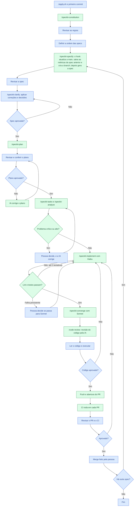
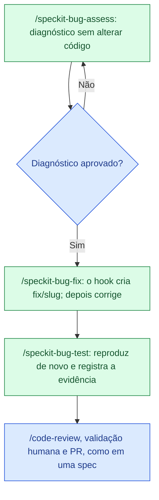

# Guia: do diretório vazio ao primeiro PR

Passo a passo para criar qualquer projeto com Spec Kit e Claude Code, em qualquer linguagem ou framework: a IA propõe e executa, e a pessoa decide.

**Situação:** em validação. Já funcionou em uma spec real: especificação e plano em subagente com Sonnet, dúvidas na conversa principal e implementação de 36 tarefas com Haiku, a partir de tarefas detalhadas pelo Sonnet. Ainda falta validar o limite de subagentes, o hook que cria a branch, o script de métricas em um ciclo novo, um ciclo completo até o merge, a extensão `bug`, uma spec técnica e uma spec que altera outra.

## Fluxo

Em azul, o que a pessoa faz; em verde, o que a IA faz.



## 1. Preparar o projeto

```bash
./apply.sh ../meu-projeto
cd ../meu-projeto
```

1. No `CLAUDE.md`, preencha a descrição e a ordem das specs.
2. Faça o primeiro commit na `main` e crie o repositório. Depois disso, toda mudança entra por PR.

   ```bash
   git add -A
   git commit -m "chore: inicializa o projeto com Spec Kit"
   gh repo create meu-projeto --private --source . --remote origin --push
   ```

3. Abra o Claude Code na pasta com `claude`. Abra uma sessão nova sempre que o contexto ficar longo.

## 2. Definir a constitution

Rode `/speckit-constitution` com regras que valem para todas as features e dá para verificar. Pode citar as ferramentas já decididas. Troque o que está entre `<>`:

```text
/speckit-constitution Projeto de <propósito> com <linguagem, framework e ferramentas já
decididas>. A documentação oficial e o que o CLI do framework gera são a referência, e
desvios precisam de justificativa. Código em inglês e documentação em português. Todo
comportamento novo tem teste: testes unitários isolam dependências externas com mocks, e
testes de integração usam as dependências reais. Lint e testes rodam no CI em cada PR.
Nenhuma abstração sem um problema atual que a justifique. As specs seguem o modelo
flow-forward: depois do merge, uma pasta de specs não é editada, e uma mudança vira spec
nova que aponta para a anterior. Regras do projeto: <regras específicas e verificáveis da
arquitetura>.
```

A documentação do Spec Kit pede para registrar na constitution como as specs são mantidas, porque a ferramenta não tem um padrão ([persisting-specs](https://github.com/github/spec-kit/blob/main/docs/how-to/persisting-specs.md)).

Para decidir se uma regra entra, pergunte:

- Vale para todas as features? Se não, vai para a spec ou o plano.
- Dá para apontar uma violação no código ou no plano? "Toda regra de negócio fica fora da camada de entrada" dá; "usar Clean Code" não.
- Eu rejeitaria um PR por causa dela? Se não, é preferência.

Não fique polindo: a constitution pode ser alterada depois, rodando o comando de novo. Nossa primeira levou muitas rodadas de revisão.

## 3. Dividir em specs

Regra: **uma spec = uma branch = um PR = valor pronto para produção.**

- A primeira spec cria o projeto e a base. Depois, vá para uma capacidade por spec.
- Cada biblioteca entra na spec que a usa.
- "Pronto" significa que funciona, passou no CI e cumpre as regras no que entrega. O restante segue a ordem das specs.

A base também vira spec quando descreve um comportamento, e não uma ferramenta. As tarefas de criar o projeto com o CLI e de configurar o CI aparecem depois, em `tasks.md`.

Uma spec é pequena: entrega valor sozinha e é fácil de revisar. Não há limite de linhas. Se o specify gerar muitas histórias ou o plano ficar grande, divida em specs que ainda entreguem valor cada uma.

### Tipos de mudança

O Spec Kit não escolhe por você como manter as specs. A documentação descreve quatro modelos, e este guia usa o **flow-forward**: depois do merge, uma pasta de `specs/` não é editada e vira histórico. Uma mudança no que já foi entregue vira spec nova, que aponta para a anterior, e o agente consegue seguir a sequência. Os outros modelos são editar o `spec.md` existente (living spec), deixar spec e código se ajustarem (flow-back) ou apagar as specs depois da entrega (constitution-only, usado pelo próprio repositório do Spec Kit).

| Mudança | Fluxo | Branch | Histórico | Origem |
|---|---|---|---|---|
| Funcionalidade nova ou melhoria | Fluxo completo | `feature/` | `specs/<pasta>/` | Spec Kit |
| Feature grande demais para uma spec | `roadmap.md`, depois uma spec por fatia | `feature/` em cada fatia | `specs/<épico>/roadmap.md` | Spec Kit ([spec of specs](https://github.com/github/spec-kit/blob/main/docs/how-to/spec-of-specs.md)) |
| Bug: o código contraria uma spec | Extensão `bug` | `fix/` | `.specify/bugs/<slug>/` | Spec Kit ([bugfix](https://github.com/github/spec-kit/blob/main/docs/guides/bugfix.md)) |
| Tarefa técnica que precisa de plano | Fluxo completo, como spec técnica | `feature/` | `specs/<pasta>/` | Este modelo |
| Tarefa técnica trivial | PR direto | `chore/` | Commits e PR | Este modelo |

**Spec que altera outra.** Cite a spec anterior na descrição do `/speckit-specify`. O `spec.md` começa com duas linhas: `Tipo: funcionalidade` ou `Tipo: técnica`, e `Altera: specs/<pasta>`, quando houver uma spec relacionada.

**Feature grande.** A documentação chama de "spec of specs", e o equivalente no Jira é o épico. Antes das specs, um `roadmap.md` lista as fatias em uma tabela: ID fixo (R1, R2...), intenção, o que entra e o que fica para outra fatia, dependências, status e o link da spec de cada fatia. Cada fatia é completa e entrega valor sozinha: "cadastrar produto com nome e preço" vai para produção, e "acrescentar categoria" vem na fatia seguinte. Não há comando para isso. A própria documentação recomenda usar só quando a feature não cabe em uma spec.

**Bug ou mudança.** Se o código contraria o que a spec acordou, é bug. Se o que foi acordado precisa mudar, é spec nova.

**Tarefa técnica.** O Spec Kit não trata desse caso. No mercado, ela é um item próprio do backlog: chore no Pivotal Tracker, task no Jira, enabler story no SAFe. O critério deste modelo:

- **Precisa de plano** (tem uma decisão ou mais de uma tarefa, como refatorar um módulo ou trocar uma biblioteca com breaking change): spec técnica. Quem usa é quem mantém ou opera o sistema, e os critérios de aceite são observáveis, como "os testes continuam passando" ou "o contrato da API não muda".
- **Não precisa de plano** (atualizar uma dependência patch, ajustar o CI, corrigir um texto): PR `chore/` direto, com o motivo na descrição. É feito com IA e revisão, o que não é vibe coding: vibe coding é aceitar código sem ler.

Lição de um projeto anterior: com uma segunda ferramenta só para mudanças, como o OpenSpec, ficavam dois fluxos para manter.

### Ciclo de um bug



O diagnóstico, a correção e o teste ficam em `.specify/bugs/<slug>/` e entram no PR. O resultado do teste é `verified`, `partial` ou `failed`.

## 4. Ciclo de cada spec

| # | Etapa | Comando | Quem produz | Sua parte |
|---|---|---|---|---|
| 1 | Especificação | `/speckit-specify` | IA, com sua descrição | Descreva comportamento, sem tecnologia |
| 2 | Dúvidas | `/speckit-clarify` | IA pergunta | **Revise a spec e decida** |
| 3 | Plano | `/speckit-plan` | IA | **Revise e aprove** |
| 4 | Tarefas | `/speckit-tasks` e `/speckit-analyze` | IA | Só decide se houver problema crítico ou alto |
| 5 | Implementação | `/speckit-implement` e `/speckit-converge` | IA | - |
| 6 | Validação da IA | `/code-review` | IA | Decida o que corrigir |
| 7 | Validação humana | - | Pessoa | Leia o código e execute a feature |
| 8 | Pull request | - | IA abre | **Revise e faça o merge** |

Uma etapa por vez. Você digita os comandos, e uma aprovação vale só para a etapa revisada.

O Spec Kit não tem um comando de revisão de código. O `/speckit-converge` confere se o código cumpre spec, plano e tarefas, e o `/code-review`, do Claude Code, procura bugs. Os dois são necessários, porque um código pode cumprir a spec e ainda ter problemas.

### Spec

O `/speckit-specify` roda antes o hook `before_specify`, registrado em `.specify/extensions.yml`. A skill `speckit-feature-branch` atualiza a `main`, salva as métricas da spec anterior se ela foi mergeada e cria `feature/<nome-curto>`. Com alterações sem commit ou branch não mergeada, ela para e pergunta. Quem executa o hook é a própria IA, seguindo a skill, então confira a branch no resumo.

```text
/speckit-specify <Nome da capacidade>. <Quem> consegue <fazer o quê>, e <o que acontece
nos casos de erro>. Fora do escopo: <o que fica para as próximas specs>.
```

O checklist da própria IA pode passar tudo e deixar excessos. Antes de aprovar, confira:

- Requisitos e metas que você não pediu, como "100% das tentativas" ou prazos sem origem.
- O que a sua infraestrutura não consegue cumprir, como bloquear merge em repositório privado sem GitHub Pro.
- Código próprio para o que a ferramenta já faz, como mensagens de erro que ela já dá.
- Frases ambíguas, como "voltar ao estado anterior", que podem esconder uma decisão.

Aplique as correções com `/speckit-clarify`. Não rode `/speckit-specify` de novo, porque ele cria outra pasta.

### Plano

```text
/speckit-plan Use <decisões técnicas ainda abertas>. Siga a documentação oficial e o que o
CLI do framework gera, e justifique cada biblioteca. Mantenha o plano simples, sem
antecipar as specs seguintes.
```

Antes de aprovar, confira:

- **Ferramentas:** gere o scaffold do framework em uma pasta temporária, em vez de confiar no que o plano diz que ele traz. Já vimos um plano citar ferramentas que a versão atual do CLI não gerava mais.
- **Comandos críticos:** faça um teste rápido do que o plano assume. Já vimos um comando de "esperar ficar pronto" retornar sucesso em um serviço que caiu logo depois, e um mesmo processo sair com códigos diferentes conforme o ambiente.
- **Arquivos do scaffold:** veja o que o CLI traz além do código, como instruções para IA ou serviços de terceiros que você não escolheu.
- **Testes:** o que a constitution manda testar não pode ficar só como verificação manual ou "onde for viável".
- **Clone novo e CI:** de onde vêm as variáveis de ambiente, as portas e as dependências.
- **Sua máquina:** veja se as portas do plano estão livres (`ss -ltn`). Um teste que mira a porta padrão pode até atingir o serviço de outro projeto.

## 5. Convenções

- **Idioma:** código em inglês; documentação, specs, planos, commits e PRs em português.
- **Referência:** a documentação oficial e o que o CLI do framework gera. Desvios ficam justificados no Complexity Tracking do plano.
- **Testes:** unitários isolam dependências externas com mocks, e os de integração usam as dependências reais.
- **Simplicidade:** nenhuma abstração, camada ou dependência sem um problema atual.
- **Segredos:** nunca no repositório.

## 6. Subagentes e modelos

Cada comando digitado roda direto no subagente, configurado no frontmatter da skill com `context: fork`, `background: false` e `model`. Isso mantém a conversa principal pequena e usa um modelo adequado a cada tarefa.

| Etapa | Modelo | Onde roda |
|---|---|---|
| Conversa principal (orquestrador) | Sonnet | - |
| Constitution | Opus | Subagente |
| Spec, plano, tarefas, análise e converge | Sonnet | Subagente |
| Dúvidas da spec e diagnóstico de bug | Sonnet | Conversa principal, porque dependem de diálogo |
| Correção e teste de bug | Sonnet | Subagente |
| Implementação | Haiku, passando para Sonnet se a mesma falha persistir depois de 3 tentativas | Subagente |
| Validação da IA (`/code-review`) | Sonnet, o modelo da conversa principal | Conversa principal, com revisores próprios |
| `/metrics` | Haiku | Subagente |

- **Perguntas:** o subagente não vê o chat. Ele devolve as perguntas, o orquestrador mostra cada uma com uma recomendação, você decide, e a decisão vai para o artefato da etapa.
- **Máquina:** o modelo roda nos servidores, mas build, testes e contêineres rodam localmente. Ajuste `CLAUDE_CODE_MAX_CONCURRENT_SUBAGENTS` em `.claude/settings.json`. O padrão do modelo é 2, e ainda não sabemos se esse limite cobre skills com fork.
- **Atualização do Spec Kit:** pode sobrescrever o frontmatter. Confira com `git diff` e reaplique.

## 7. Limites do plano

- Eles medem consumo, não horas: uma janela de 5 horas, que começa na primeira mensagem, e um limite semanal.
- São compartilhados entre os modelos e com o Claude no navegador, no desktop e no celular. A Anthropic não publica o tamanho deles e pode ajustá-los.
- O consumo depende do modelo, do esforço e do tamanho do contexto. Cada subagente faz as próprias requisições, que contam no mesmo limite.
- Use `/usage` para acompanhar e `/clear` ou uma sessão nova entre tarefas para reduzir o contexto.

## 8. Registros

Sem interação humana e sem registro durante as etapas:

- **`docs/metrics/<branch>.md`:** gerado por `.claude/metrics.py` a partir das transcrições do Claude Code e do GitHub. O hook do specify salva o da spec anterior depois do merge, e `/metrics [branch]` gera à mão. Traz:
  - tempo de relógio, do primeiro pedido ao merge;
  - tempo da IA por etapa, do pedido à última resposta, incluindo esperas por permissão;
  - intervalos entre os turnos;
  - tokens por modelo;
  - tempo do PR de aberto a merge, que funciona mesmo quando quem revisa é outra pessoa.
- **`docs/diario.md`:** o que a IA propôs, o que você mudou e por quê, surpresas e erros.

Uma etapa começa no pedido com o comando (`/speckit-plan`) e inclui as conversas seguintes até o próximo comando, como revisões e correções. Os intervalos incluem revisão, pausas e noites, então são um limite máximo do tempo humano.

Uma regra que pedia à IA para registrar tempos e consumo a cada etapa foi abandonada: custava tempo e tokens em toda etapa, e o tempo humano continuava aproximado. Pelo mesmo motivo, o `/hr`, que marcava o início e o fim da revisão, também saiu.

## 9. Git

- Branches a partir da `main` atualizada: `feature/<nome-curto>` para specs e `fix/<slug>` para bugs, criadas pelo hook, e `chore/<nome-curto>` para tarefas técnicas triviais.
- A `main` não recebe commit direto.
- Um commit ao fim de cada etapa aprovada e, na implementação, um por tarefa ou pequeno grupo. Push e PR ficam para o final.
- Commits e títulos de PR usam `tipo: descrição`, no presente e em português, como `feat: adiciona cadastro`. Tipos: `feat`, `fix`, `docs`, `test`, `refactor` e `chore`.
- O corpo do PR segue `.github/pull_request_template.md`.
- As specs são numeradas por horário, para evitar número repetido em trabalho paralelo.
- Repositório privado sem GitHub Pro não permite proteger a branch, e você não consegue aprovar um PR aberto com a própria conta. Nesse caso, o merge vale como aprovação.

## 10. Quando automatizar mais

Só depois de validar o fluxo com dados de tempo, consumo e retrabalho. Comece por tarefas de baixo risco, como testes e dependências. Cada spec depende do merge da anterior, então um loop entre specs para nesse ponto.
