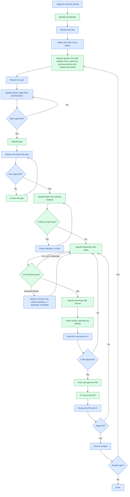
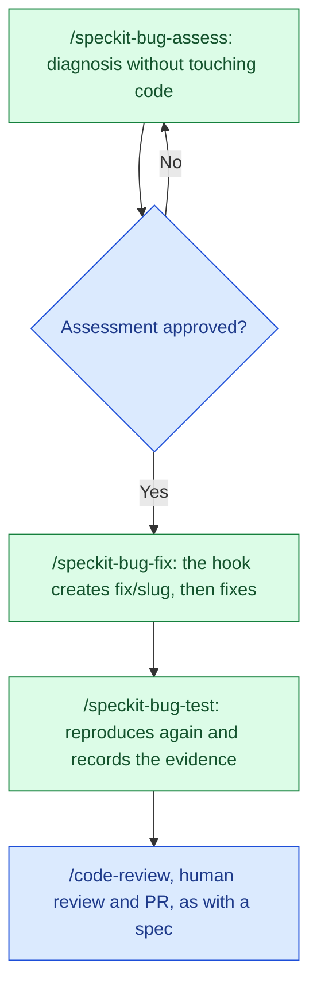

# Guide: from an empty directory to the first PR

How to build any project with Spec Kit and Claude Code: the AI proposes and executes, the person decides. The project rules live in `files/CLAUDE.md`; this guide covers how to use them.

**Status:** being validated. One real spec went through specify, plan and an implementation of 36 tasks with Haiku. Not yet validated: the subagent limit, the branch hooks, the metrics script in a new cycle, a full cycle up to the merge, the `bug` extension, a technical spec and a spec that builds on another.

## Flow

Blue: the person. Green: the AI.



## 1. Set up the project

```bash
./apply.sh ../my-project        # artifacts in English (en)
./apply.sh ../my-project pt-BR  # or any other BCP 47 language tag
cd ../my-project
```

1. In `CLAUDE.md`, fill in the description and the order of the specs.
2. Make the first commit on `main` and create the repository. From then on, every change goes through a PR.

   ```bash
   git add -A
   git commit -m "chore: initialize the project with Spec Kit"
   gh repo create my-project --private --source . --remote origin --push
   ```

3. Run `claude` in the folder. Start a new session whenever the context gets long.

## 2. Constitution

Run `/speckit-constitution` with rules that apply to every feature and can be checked. Replace what is between `<>`:

```text
/speckit-constitution <Purpose> project with <language, framework and tools already chosen>.
The official docs and what the framework CLI generates are the reference; deviations need a
justification. Every new behavior has tests: unit tests mock external dependencies, and
integration tests use the real ones. Lint and tests run in CI on every PR. No abstraction
without a current problem. Specs are flow-forward: after the merge, a spec directory is not
edited, and a change is a new spec that links to the previous one. Project rules: <specific,
checkable architecture rules>.
```

Spec Kit has no default for how specs are kept and asks you to record your choice in the constitution ([persisting specs](https://github.com/github/spec-kit/blob/main/docs/how-to/persisting-specs.md)).

A rule belongs in the constitution if:

- it applies to every feature (otherwise it goes in the spec or plan);
- a violation can be pointed at in the code or plan ("business rules stay out of the entry layer" can; "use Clean Code" cannot);
- you would reject a PR over it.

Don't polish it: you can change it later by running the command again.

## 3. Split the work

**One spec = one branch = one PR = production-ready value.**

- The first spec creates the project and its foundation. After that, one capability per spec.
- Each library comes in with the spec that uses it.
- A spec is small: it delivers value on its own and is easy to review. There is no line limit.

### Kinds of change

Spec Kit describes four ways to keep specs ([persisting specs](https://github.com/github/spec-kit/blob/main/docs/how-to/persisting-specs.md)). This template uses **flow-forward**: merged spec directories are history, and a change is a new spec that links to the previous one, so the agent can follow the sequence.

| Change | Flow | Branch | Source |
|---|---|---|---|
| New feature or improvement | Full flow | `feature/` | Spec Kit |
| Feature too large for one spec | `roadmap.md`, then one spec per slice | `feature/` | Spec Kit ([spec of specs](https://github.com/github/spec-kit/blob/main/docs/how-to/spec-of-specs.md)) |
| Bug: the code contradicts a spec | `bug` extension | `fix/` | Spec Kit ([bugfix](https://github.com/github/spec-kit/blob/main/docs/guides/bugfix.md)) |
| Technical task that needs a plan | Full flow, as a technical spec | `feature/` | This template |
| Trivial technical task | Direct PR | `chore/` | This template |

- **Spec that changes another:** cite the previous spec in the `/speckit-specify` description. `spec.md` starts with `Type: feature` or `Type: technical` and `Builds on: specs/<dir>`.
- **Large feature:** the roadmap is the epic. Each slice is complete and delivers value on its own: "register a product with name and price" ships, and "add a category" comes in the next slice. Spec Kit recommends it only when a feature does not fit in one spec.
- **Technical task:** Spec Kit does not cover it. Trackers treat it as its own item: chore in Pivotal Tracker, task in Jira, enabler story in SAFe. If it needs a plan (a decision or more than one task), it is a technical spec; otherwise, a `chore/` PR with the reason in the description.

### Bug cycle



The assessment, fix and test reports stay in `.specify/bugs/<slug>/` and go into the PR. The test verdict is `verified`, `partial` or `failed`.

## 4. Spec cycle

Spec Kit has no code review command. `/speckit-converge` checks that the code matches spec, plan and tasks; `/code-review` looks for bugs. You need both: code can match the spec and still be wrong.

### Spec

```text
/speckit-specify <Capability>. <Who> can <do what>, and <what happens on errors>.
Out of scope: <what is left for later specs>.
```

The AI's own checklist can pass everything and still leave excess. Before approving, check for:

- requirements and targets you did not ask for, like "100% of attempts" or deadlines with no source;
- what your infrastructure cannot do, like blocking merges in a private repository without GitHub Pro;
- custom code for what the tool already does;
- ambiguous sentences that hide a decision.

Apply the fixes with `/speckit-clarify`. Don't rerun `/speckit-specify`: it creates another directory.

### Plan

```text
/speckit-plan Use <technical decisions still open>. Follow the official docs and what the
framework CLI generates, and justify each library. Keep the plan simple and don't anticipate
later specs.
```

Before approving, check:

- **Tooling:** generate the framework scaffold in a temporary folder instead of trusting what the plan says it contains.
- **Critical commands:** quickly test what the plan assumes, like "wait until ready" commands and exit codes.
- **Scaffold files:** what the CLI adds besides code, like AI instructions or third-party services you did not choose.
- **Tests:** what the constitution requires cannot become manual checks or "where feasible".
- **Fresh clone and CI:** where environment variables, ports and dependencies come from.
- **Your machine:** whether the plan's ports are free (`ss -ltn`).

## 5. Subagents and usage

Each command runs in its subagent and model, set in the skill frontmatter (`context: fork`, `background: false`, `model`). The table is in `CLAUDE.md`.

- Build, tests and containers run locally. Tune `CLAUDE_CODE_MAX_CONCURRENT_SUBAGENTS` in `.claude/settings.json`.
- The `Automation` section of `CLAUDE.md` turns on or off the automatic `/code-review` after converge (on by default) and the automatic Haiku-to-Sonnet switch after 3 failed attempts (off by default). Edit it at any time.
- A Spec Kit upgrade can overwrite the frontmatter. Check with `git diff` and reapply.
- Plan limits are a 5-hour window and a weekly limit, shared across models, subagents and Claude apps. Track them with `/usage` and the status line, and use `/clear` between tasks.

## 6. Records

No logging during the steps and no human input:

- **`docs/metrics/<branch>.md`:** written by `.claude/metrics.py` from Claude Code transcripts and GitHub. The hooks save it for the merged branch, and `/metrics [branch]` writes it by hand. It shows wall-clock time, AI time per step, gaps between turns, tokens by model and the PR's open-to-merge time. Gaps include review, breaks and nights, so they are an upper bound for human time.
- **`docs/journal.md`:** what the AI proposed, what you changed and why, surprises and mistakes.

## 7. Git

- Specs are numbered by timestamp, to avoid duplicates in parallel work.
- A private repository without GitHub Pro cannot protect branches, and you cannot approve your own PR. There, the merge counts as the approval.

## 8. Automating more

Only after the flow is validated with time, usage and rework data. Start with low-risk tasks, like tests and dependencies. Each spec depends on the previous merge, so a loop across specs stops there.
