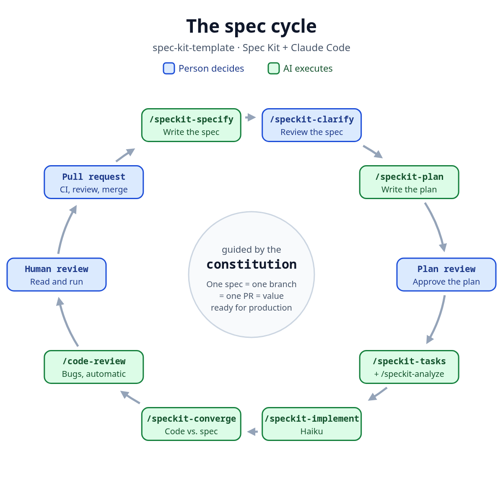

# Spec Kit and Claude Code project template

Sets up a new project, in any language or framework, with a workflow of human review stops, subagents, a model per step, automatic metrics and conventions for code, commits and PRs.

<p align="center"></p>

Blue steps are the person's, green steps are the AI's. One spec = one branch = one PR = production-ready value.

**The step-by-step guide and the flow diagram are in [GUIDE.md](GUIDE.md).**

The story behind it: [LinkedIn post](https://www.linkedin.com/feed/update/urn:li:activity:7525892151277441024/) (in Portuguese).

## Usage

Requires `specify`, `git`, `jq`, `python3` and Claude Code.

```bash
./apply.sh ../my-project [language-tag]
```

The language tag ([BCP 47](https://www.rfc-editor.org/info/bcp47), like `en` or `pt-BR`) applies to replies, constitution, specs, plans, docs, commits and PRs (default: `en`). Code is always in English. The script only accepts a new or empty directory, runs `specify init`, copies `files/`, installs the `bug` extension, adjusts skills and numbering, and commits nothing.

## What it configures

| File | Purpose |
|---|---|
| `CLAUDE.md` | Collaboration, flow, kinds of change, conventions, Git, subagents and records |
| `.claude/settings.json` | Sonnet in the main conversation, up to 2 subagents and the status line |
| `.claude/skills/speckit-*/SKILL.md` | Subagent and model per step |
| `.claude/statusline.sh` | 5-hour and weekly usage |
| `.specify/extensions.yml` and the `speckit-feature-branch` skill | Before specify and bug fix: update `main`, save the previous branch's metrics and create the branch |
| Spec Kit `bug` extension | Bug assessment, fix and test in `.specify/bugs/<slug>/` |
| `.claude/metrics.py` and `/metrics [branch]` | Branch metrics with no human input: time, tokens by model and PR, in `docs/metrics/` |
| `.github/pull_request_template.md` | PR body |
| `docs/journal.md` | What happened at each step |
| `.specify/init-options.json` | Specs numbered by timestamp |

## Contributing

See [CONTRIBUTING.md](CONTRIBUTING.md).

## License

[MIT](LICENSE).
